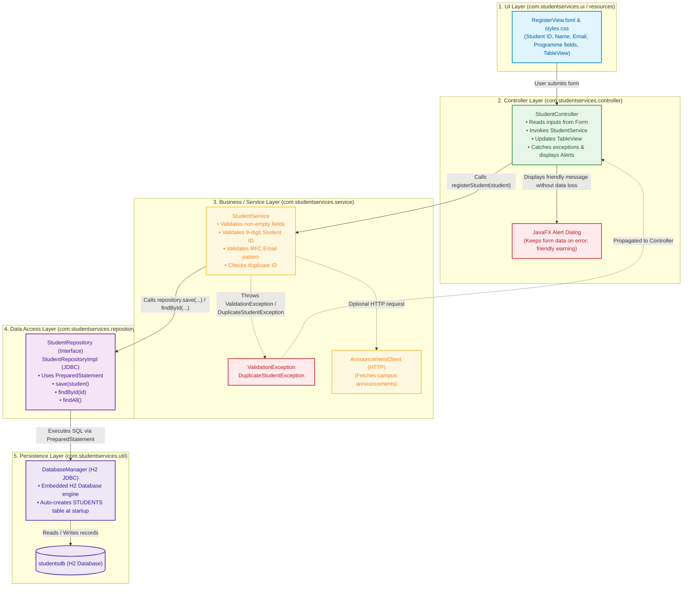

# Layered Architecture Diagram

**Project:** Student Services Desktop App  
**Student:** Isaac Miti (ID: 202509238)  
**Institution:** Mulungushi University, School of Engineering and Technology  
**Course:** ICT261 Advanced Java Programming (Unit 1)  
**Lecturer:** Mr. E. Nyirenda  

---

## 1. Architectural Overview

The application adheres to a **Strict One-Way Layered Architecture**. Each component only interacts with the layer directly below it. The presentation layer never queries the repository or database directly, ensuring low coupling, high maintainability, and clean testability.

### Strict Dependency Direction:
```
JavaFX UI (FXML / Views)
          │
          ▼
Controller (StudentController)
          │
          ▼
Service (StudentService) ──────► (Optional Client: AnnouncementClient)
          │
          ▼
Repository (StudentRepository - JDBC)
          │
          ▼
Database (Embedded H2 / SQLite)
```

---

## 2. Architecture Diagram (Mermaid)



---

## 3. Error Handling Boundary & Data Flow

1. **Input Submission:** The user fills the student form and clicks **Register Student**.
2. **Controller Delegation:** The `StudentController` extracts strings and passes them to `StudentService.register(...)`.
3. **Validation & Duplicate Checking:**
   - If fields are empty, or the ID is not 9 digits, or the email is invalid, `StudentService` throws `ValidationException`.
   - If `StudentRepository.findById(id)` returns an existing student, `StudentService` throws `DuplicateStudentException`.
4. **Boundary Interception:** The `StudentController` catches these custom exceptions inside a `try-catch` block.
5. **Safe Response:** The controller triggers a JavaFX `Alert` with an informative message (e.g., *"Student ID 202509238 is already registered"*). **Crucially, the form fields remain populated**, allowing the student or administrator to correct the error without starting over. The app never crashes.
